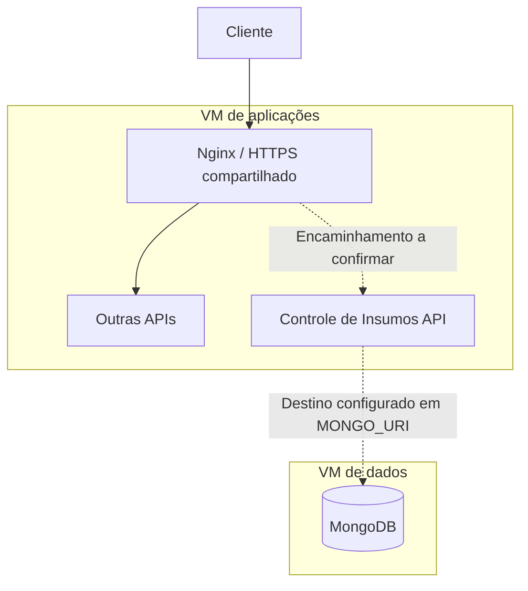

<a id="topo"></a>

# 📦 Controle de Insumos API

### Backend REST para gestão de insumos e estoque

**Organize fornecedores, insumos e movimentações de estoque por usuário.**

Desenvolvida com Fastify, TypeScript e MongoDB, com autenticação JWT e confirmação de cadastro por e-mail.


[Começar](#como-executar-localmente) · [Variáveis de ambiente](#variaveis-de-ambiente) · [Endpoints](#endpoints) · [Testes](#testes) · [Infraestrutura](#infraestrutura-e-deploy)

---

## 📖 Sobre o projeto

A API centraliza o cadastro de insumos e fornecedores e registra compras, vendas e ajustes de estoque. Os recursos protegidos são associados ao usuário autenticado. O cadastro exige confirmação de e-mail antes do login.

### ✨ Funcionalidades

- Cadastro, confirmação de e-mail, login e exclusão de conta com senha.
- Consulta do usuário autenticado e proteção das rotas por token JWT.
- Cadastro, listagem, atualização e exclusão de fornecedores e insumos.
- Registro e edição de compras, vendas e ajustes, com cálculo de estoque e total.
- Exclusão individual ou em lote de registros do usuário.
- Health check, CORS configurável e interface Swagger em `/docs`.

---

## 🛠️ Stack técnica

| Tecnologia | Uso |
| --- | --- |
| Node.js e TypeScript | Execução e desenvolvimento da API |
| Fastify | Servidor HTTP, rotas e plugins |
| MongoDB e Mongoose | Persistência e modelos de dados |
| Zod | Validação dos dados recebidos |
| JSON Web Token e bcryptjs | Autenticação e hash de senhas |
| Nodemailer | Envio de confirmação de cadastro via SMTP |
| Jest, Supertest e Node.js Test Runner | Testes HTTP e de regras de negócio |
| Docker e GitHub Actions | Empacotamento e fluxo de deploy |

---

<a id="como-executar-localmente"></a>

## 🚀 Como executar localmente

### Pré-requisitos

- Node.js 22 e npm.
- MongoDB acessível pela aplicação.
- Serviço SMTP com host, porta e credenciais configurados para envio de e-mail.
- Git para clonar o repositório.

### Instalação

```sh
git clone https://github.com/ALVAROVELAME/controle-de-insumos-api.git
cd controle-de-insumos-api
npm ci
```

Crie `.env` a partir de `.env.example` e preencha as configurações. No PowerShell:

```powershell
Copy-Item .env.example .env
```

Em macOS ou Linux, use `cp .env.example .env`. Configure especialmente MongoDB, SMTP e `JWT_SECRET`. As variáveis `MAIL_*` são obrigatórias na inicialização, mesmo quando não se pretende enviar e-mails durante o desenvolvimento.

```sh
npm run dev
```

Com a configuração padrão, a API fica em `http://localhost:3000`, o health check em `GET /` e a interface Swagger em `http://localhost:3000/docs`. O servidor só começa a escutar após a conexão inicial com o MongoDB; depois de iniciado, o health check responde ao HTTP, mas **não verifica a disponibilidade atual do MongoDB ou do SMTP**. As tabelas de endpoints abaixo e os DTOs em `src/dtos/` descrevem os contratos implementados; as rotas atualmente não têm todos os esquemas de entrada e resposta registrados no Swagger.

---

<a id="variaveis-de-ambiente"></a>

## ⚙️ Variáveis de ambiente

Use [`.env.example`](.env.example) como modelo. Não publique o arquivo `.env` nem credenciais reais no repositório.

| Variável | Obrigatória | Descrição e padrão |
| --- | --- | --- |
| `NODE_ENV` | Não | Ambiente da aplicação; padrão `Development`. |
| `PORT` | Não | Porta HTTP; padrão `3000`. |
| `MONGO_URI` | Sim | URI de conexão do MongoDB. |
| `MAIL_HOST` | Sim | Host do servidor SMTP. |
| `MAIL_PORT` | Sim | Porta SMTP; a porta `465` ativa conexão segura direta. |
| `MAIL_USERNAME` | Sim | Usuário de autenticação SMTP. |
| `MAIL_PASSWORD` | Sim | Senha de autenticação SMTP. |
| `MAIL_FROM` | Sim | Endereço remetente dos e-mails. |
| `JWT_SECRET` | Sim | Chave de assinatura JWT, com pelo menos 32 caracteres. Use um valor exclusivo e seguro em produção. |
| `JWT_EXPIRATION` | Não | Validade do JWT em **milissegundos**; padrão `86400000` (24 horas). |
| `JWT_ISSUER` | Não | Emissor do JWT; padrão `controle-de-insumos-api`. |
| `JWT_AUDIENCE` | Não | Audiência do JWT; padrão `controle-de-insumos-api`. |
| `APP_BASE_URL` | Não | URL pública da API informada ao Swagger; padrão `http://localhost:3000`. |
| `APP_FRONTEND_URL` | Não | URL base usada no link de confirmação; padrão `http://localhost:5173`. |
| `CORS_ORIGIN` | Não | Origens permitidas, separadas por vírgula; padrão `http://localhost:5173`. |

O link enviado por e-mail segue o formato `APP_FRONTEND_URL/confirmar?token=...`. A aplicação cliente precisa receber esse token e chamar a rota de confirmação da API. O token de confirmação do cadastro é válido por 24 horas. A validade do JWT é uma configuração independente.

---

## 📜 Scripts disponíveis

| Comando | Descrição |
| --- | --- |
| `npm run dev` | Inicia o servidor de desenvolvimento com observação de arquivos. |
| `npm run build` | Compila o TypeScript para `dist/`. |
| `npm start` | Executa `dist/server.js` após a compilação. |
| `npm run typecheck` | Verifica os tipos sem gerar arquivos. |
| `npm test` | Executa os testes de regras de negócio e HTTP. |
| `npm run test:unit` | Executa os testes com o Node.js Test Runner. |
| `npm run test:http` | Compila e executa os testes HTTP com Jest e Supertest. |
| `npm run test:coverage` | Gera a cobertura da suíte Jest em `coverage/`. |

---

## 🏗️ Arquitetura e estrutura

O fluxo principal de uma requisição é `rotas → controllers → services → repositories → models`. Os DTOs validam as entradas; os middlewares tratam autenticação e erros. `criarApp` monta o Fastify e suas rotas, enquanto `server.ts` conecta ao MongoDB e inicia o servidor.

```text
src/
├── app.ts               # Montagem do Fastify e dos plugins
├── server.ts            # Conexão com MongoDB e inicialização HTTP
├── config/              # Variáveis de ambiente
├── controllers/         # Entrada e resposta HTTP
├── database/            # Conexão com MongoDB
├── dtos/                # Contratos e validação
├── errors/              # Erros da aplicação
├── middlewares/         # Autenticação e tratamento de erros
├── models/              # Modelos Mongoose
├── repositories/        # Consultas e persistência
├── routes/              # Registro dos endpoints
├── security/            # Geração e validação de JWT
└── services/            # Regras de negócio e envio de e-mail
tests/
├── http/                # Testes HTTP com Jest e Supertest
└── unit/                # Testes de regras de negócio e SMTP local simulado
```

---

## 🔐 Autenticação

1. Envie nome, e-mail e senha para `POST /api/usuarios`.
2. Abra o link de confirmação enviado ao e-mail e confirme o token por `GET /api/auth/confirmar?token=...`.
3. Envie e-mail e senha para `POST /api/auth/login` e utilize o token retornado nas rotas protegidas:

```http
Authorization: Bearer <token>
```

A confirmação é feita pela rota do frontend indicada em `APP_FRONTEND_URL`; essa tela deve encaminhar o token à API. A exclusão de conta exige a senha e também remove os dados associados ao usuário.

O cadastro pendente é gravado antes da tentativa de envio do e-mail. Se o envio falhar, o registro pendente pode permanecer; a implementação atual também não fornece uma rota de reenvio ou renovação de token expirado. Um novo cadastro com o mesmo e-mail pendente é recusado.

---

<a id="endpoints"></a>

## 🌐 Endpoints da API

### 🔓 Saúde e conta

| Método | Caminho | Autenticação | Descrição |
| --- | --- | --- | --- |
| GET | `/` | Não | Health check da API. |
| POST | `/api/usuarios` | Não | Inicia o cadastro e envia o e-mail de confirmação. |
| POST | `/api/auth/login` | Não | Autentica e retorna um JWT. |
| GET | `/api/auth/confirmar?token=...` | Não | Confirma o cadastro pelo token. |
| GET | `/api/auth/me` | Sim | Retorna dados do usuário autenticado. |
| GET | `/api/usuarios/me` | Sim | Retorna dados da conta autenticada. |
| POST | `/api/usuarios/me/excluir` | Sim | Exclui a conta; recebe `{ "senha": "..." }`. |

### 🔒 Fornecedores, insumos e movimentações

Todas as rotas abaixo exigem JWT. Substitua `{recurso}` por `fornecedores`, `insumos` ou `movimentacoes`.

| Método | Caminho | Descrição |
| --- | --- | --- |
| GET | `/api/{recurso}` | Lista os registros do usuário. |
| POST | `/api/{recurso}` | Cria um registro. |
| PUT | `/api/{recurso}/:id` | Atualiza um registro com o DTO completo. |
| DELETE | `/api/{recurso}/:id` | Exclui um registro. |
| DELETE | `/api/{recurso}` | Exclui todos os registros desse recurso pertencentes ao usuário. |

> **Atenção às exclusões**
>
> - Excluir um insumo também remove suas movimentações.
> - Excluir fornecedores desvincula suas referências em insumos e movimentações.
> - Excluir uma movimentação individual reverte seu efeito no estoque, desde que o saldo resultante não fique negativo.
> - Excluir **todas** as movimentações remove o histórico, mas não recalcula o estoque dos insumos.
> - Excluir a conta remove movimentações, insumos e fornecedores do usuário.

### 📡 Exemplos de requisição

Cadastro:

```http
POST /api/usuarios
Content-Type: application/json

{ "nome": "Ana Silva", "email": "ana@example.com", "senha": "senha123" }
```

Após confirmar o e-mail, faça login:

```http
POST /api/auth/login
Content-Type: application/json

{ "email": "ana@example.com", "senha": "senha123" }
```

Uma resposta de sucesso contém o token e os dados públicos do usuário:

```json
{
  "sucesso": true,
  "mensagem": "Login realizado com sucesso",
  "token": "<jwt>",
  "tipo": "Bearer",
  "usuario": {
    "id": "<id-do-usuario>",
    "nome": "Ana Silva",
    "email": "ana@example.com",
    "ativo": true
  }
}
```

Criação de fornecedor autenticada:

```http
POST /api/fornecedores
Authorization: Bearer <token>
Content-Type: application/json

{
  "nome": "Distribuidora Exemplo",
  "email": "contato@example.com",
  "telefone": "71999999999"
}
```

Exemplo de criação de insumo autenticada:

```http
POST /api/insumos
Authorization: Bearer <token>
Content-Type: application/json

{
  "nome": "Arroz",
  "categoria": "Alimentos",
  "unidade": "kg",
  "quantidadeAtual": 10,
  "quantidadeMinima": 2,
  "precoCompra": 5.50,
  "precoVenda": 8.00
}
```

O fornecedor é opcional: para associá-lo, acrescente `"fornecedorId": "<id-do-fornecedor>"` ao insumo. Para registrar uma compra:

```http
POST /api/movimentacoes
Authorization: Bearer <token>
Content-Type: application/json

{
  "insumoId": "<id-do-insumo>",
  "tipo": "Compra",
  "quantidade": 5,
  "precoUnitario": 5.50,
  "data": "2026-01-15"
}
```

### 📋 Regras e campos importantes

| Recurso | Campos obrigatórios na criação e no `PUT` | Campos opcionais |
| --- | --- | --- |
| Fornecedor | `nome` | `documento`, `telefone`, `email`, `observacoes`, `ativo` |
| Insumo | `nome`, `categoria`, `unidade`, `quantidadeAtual`, `quantidadeMinima`, `precoCompra`, `precoVenda` | `fornecedorId`, `observacoes`, `ativo` |
| Movimentação | `insumoId`, `tipo`, `quantidade`, `precoUnitario`, `data` | `fornecedorId`, `cliente`, `observacoes` |

Os valores de `tipo` são `Compra`, `Venda` e `Ajuste`. Para compras e vendas, a API usa o valor absoluto da quantidade: compras somam ao estoque e vendas subtraem. Ajustes usam o sinal informado e têm total zero; nos demais casos, o total é a quantidade em valor absoluto multiplicada pelo preço unitário. A quantidade deve ser um número finito e pode ser zero ou negativa; o preço não pode ser negativo. Envie uma data válida, preferencialmente no formato ISO 8601: o DTO exige uma string não vazia e o serviço a converte para `Date`, sem validar previamente o formato.

Na criação, edição e exclusão individual, o serviço verifica o saldo calculado e rejeita operações que o deixariam negativo. Essas alterações envolvem mais de uma gravação no banco e **não são transações atômicas**: falhas ou movimentações simultâneas podem produzir inconsistências. Editar um insumo também permite alterar diretamente `quantidadeAtual`, sem criar uma movimentação.

O cadastro de usuário exige nome de 3 a 150 caracteres, e-mail válido e senha de 6 a 100 caracteres. Consulte os [DTOs](src/dtos/) para os demais limites e regras de validação.

Em erros tratados, a API normalmente retorna `{ "sucesso": false, "mensagem": "..." }`, com status como `400` para validação, `401` para autenticação, `404` para recurso não encontrado e `409` para conflito. Erros não tratados retornam `500`, inclusive alguns erros do banco. A criação de fornecedores, insumos e movimentações retorna `201`; o início do cadastro de usuário retorna `200`. Exclusões de fornecedores, insumos e movimentações retornam `204`.

---

<a id="testes"></a>

## 🧪 Testes

```sh
npm test
npm run typecheck
```

Os testes simulam os repositórios; a suíte HTTP usa a aplicação Fastify com serviços simulados. O envio de e-mail é verificado também com um servidor SMTP local simulado. Eles não substituem testes com MongoDB e SMTP reais nem verificam concorrência ou deploy. Veja [tests/README.md](tests/README.md) para detalhes.

---

<a id="infraestrutura-e-deploy"></a>

## ☁️ Infraestrutura e deploy

### 🌐 Visão do ambiente compartilhado

Esta API compartilha a VM de aplicações com outros serviços, incluindo a AgroGestor API. Segundo a documentação da infraestrutura compartilhada, o ambiente possui Nginx como proxy reverso, certificados Let's Encrypt gerenciados pelo Certbot e uma VM de dados acessível por rede privada. O MongoDB é o banco utilizado por esta API.



O diagrama representa a organização informada para a infraestrutura compartilhada; as linhas tracejadas indicam detalhes desta API que precisam ser conferidos na implantação. As configurações do Nginx, dos certificados e da rede entre VMs não estão neste repositório; o domínio público, o encaminhamento específico e o destino efetivo do MongoDB devem ser conferidos no ambiente de produção. Não é necessário compartilhar endereços internos ou credenciais nesta documentação.

### 🐳 Docker Compose

O [Dockerfile](Dockerfile) usa Node.js 22 Alpine em duas etapas: compila a aplicação e instala apenas dependências de produção na imagem final. O [docker-compose.yml](docker-compose.yml) carrega `.env`, conecta a API à rede externa `rede_api` e publica `127.0.0.1:3000:3000`.

Para usar o Compose, a rede externa deve existir e o MongoDB e SMTP devem estar acessíveis a partir do contêiner. `localhost` dentro do contêiner se refere ao próprio contêiner; ajuste `MONGO_URI` e o host SMTP conforme sua infraestrutura. O mapeamento e o health check do Compose usam a porta interna `3000`, por isso mantenha `PORT=3000` ou ajuste ambos no Compose.

```sh
docker network create rede_api
docker compose up -d --build
docker compose logs -f api
```

O comando de criação da rede é necessário apenas quando ela ainda não existe. O Compose configura limite de memória de `256m`, reinício automático, health check HTTP e rotação de logs. O health check não verifica a disponibilidade do banco ou do SMTP.

### 🚢 Deploy com GitHub Actions

O workflow em `.github/workflows/` é acionado por push em `main` e utiliza um runner próprio na infraestrutura. Ele atualiza a cópia existente em `/srv/apps/controle-de-insumos-api`, interrompe o Compose, reconstrói e inicia o serviço e, por fim, remove imagens Docker sem uso.

```text
Push em main → GitHub Actions → runner próprio → git pull
  → docker compose down → docker compose up -d --build → limpeza de imagens
```

O workflow atual **não executa os testes antes do deploy** e interrompe o serviço antes da reconstrução. Execute as verificações e avalie a atualização antes de enviar alterações para `main`.

---

## 📄 Licença

O `package.json` declara a licença ISC. Consulte o repositório para verificar os termos aplicáveis.

---

**Controle de Insumos API** · Gestão de insumos e estoque

[⬆ Voltar ao topo](#topo)
